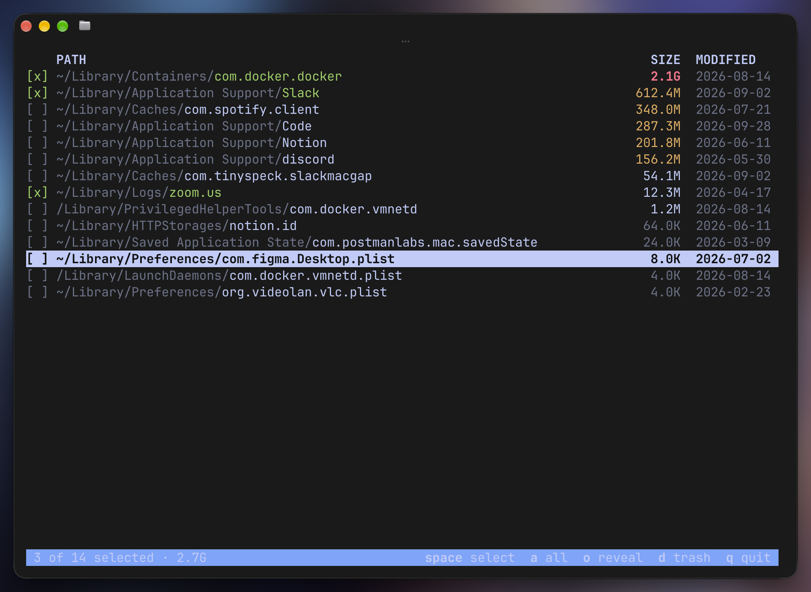

# leftovers

Terminal UI for macOS that finds files left behind by uninstalled apps — preferences, caches, containers, launch agents, helpers — and moves the ones you pick to the Trash. It can also uninstall an app together with its files.

Single Swift file, no dependencies.



## Install

Download the latest release (universal binary, macOS 12+):

```sh
mkdir -p ~/.local/bin
curl -fsSL https://github.com/pro-verstka/leftovers/releases/latest/download/leftovers-macos.tar.gz | tar -xz -C ~/.local/bin
```

If `leftovers` is then "command not found", add `~/.local/bin` to your `PATH`:

```sh
echo 'export PATH="$HOME/.local/bin:$PATH"' >> ~/.zshrc
```

The binary is not notarized. If you download it with a browser instead of `curl`, run `xattr -d com.apple.quarantine ~/.local/bin/leftovers`.

Or build from source (requires Xcode or the Command Line Tools):

```sh
make install                        # builds and copies to ~/.local/bin
make && sudo make install PREFIX=/usr/local
```

To uninstall, delete the binary (`rm ~/.local/bin/leftovers`) and, if you used it, `~/.config/leftovers`.

## Usage

```sh
leftovers               # find leftovers of apps that are already gone
leftovers --app Slack   # uninstall an app: the app plus all its files, preselected
sudo leftovers          # also lets you remove items in /Library
leftovers --list        # print path, size, date and reason instead of the UI
leftovers --help        # all options
```

`--list` is also used automatically when the output is not a terminal, e.g. `leftovers | grep Docker`.

| Key | Action |
| --- | --- |
| `↑` `↓` / `j` `k` | move |
| `PgUp` `PgDn` `g` `G` | page / top / bottom |
| `space` | select |
| `a` | select all except recently modified items / clear selection |
| `A` | select everything from the same app |
| `s` | sort by size / group by app |
| `i` | hide the item for good |
| `o` | reveal in Finder |
| `d` / `Enter` | move selected items, or the current one, to Trash (asks `y/N`) |
| `?` | help |
| `q` | quit |

The line above the status bar shows the full path of the current item and why it was listed. A yellow date means the item changed in the last 30 days and is probably still in use. `[!]` marks an item that could not be moved.

Hidden items are stored in `~/.config/leftovers/ignore`, one path per line. Edit the file to bring them back.

## How it works

It builds an index of what is installed:

- app bundles from Spotlight, `/Applications`, `~/Applications`, `/opt` and the Steam library, with their bundle IDs and nested helpers;
- app groups and team IDs from code signatures;
- the files Homebrew casks declare in their `zap` stanzas;
- command-line tools and system daemons.

Then it scans `~/Library` and `/Library` (Application Support, Caches, Containers, Group Containers, Preferences, Logs, LaunchAgents/Daemons, PrivilegedHelperTools, …) and lists entries that match nothing installed. A launchd plist is listed when its program no longer exists. `--app` runs the same scan as if the app were already gone and shows what would become leftovers.

Matching is heuristic, so check the list before deleting. Nothing is deleted outright: items go to the Trash, and Finder's **Put Back** works for them. Under `sudo` items go to your `~/.Trash` without Put Back.

Containers, Group Containers and some browser folders are protected by macOS. Their size shows as `?`, and moving them may need Full Disk Access for your terminal. The status bar warns when folders could not be read.

## Test

```sh
make test
```

## Release

Push a tag. GitHub Actions builds the universal binary and publishes it to Releases with notes from the commit messages.

```sh
git tag v0.2.0
git push origin v0.2.0
```

`make dist` builds the same archive locally into `dist/`.

## License

MIT
